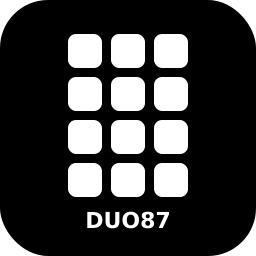

# OpenDeck Womier DUO87 Plugin

An unofficial plugin for the Womier DUO87 keyboard's detachable screen module.

## OpenDeck version

Requires OpenDeck 2.5.0 or newer

## Supported devices

- Womier DUO87 screen module (0600:3001)

## Platform support

- Linux: Tested and working
- Mac: Untested, not currently built for this platform
- Windows: Untested, not currently built for this platform

## Features

- 12-button grid with per-button custom images (80x80 JPEG)
- Profile/folder switching
- Automatic image restore after returning from the device's built-in screensaver

## Known limitations

- Screensaver image/GIF upload (the 320x480 full-screen slideshow feature in the
  official Play Deck software) is not yet supported
- Only tested against a single DUO87 unit; multi-device behavior is unverified

## Installation

1. Download an archive from [releases](https://github.com/<your-username>/opendeck-duo87/releases)
2. In OpenDeck: Plugins -> Install from file
3. Linux: install the included udev rules by copying [`70-duo87.rules`](./70-duo87.rules)
   into `/etc/udev/rules.d/` and running `sudo udevadm control --reload-rules`
4. Unplug and plug the device back in, then restart OpenDeck

## Building

### Prerequisites

- Rust with the `x86_64-unknown-linux-gnu` target installed
- `libudev-devel`, `dbus-devel`, `pkgconf-pkg-config` (Fedora package names; adjust for your distro)

### Building

```sh
$ cargo build --release
```

## Acknowledgments

This plugin is a fork of [4ndv/opendeck-akp153](https://github.com/4ndv/opendeck-akp153),
which is itself heavily based on work by contributors of the
[elgato-streamdeck](https://github.com/streamduck-org/elgato-streamdeck) crate.
Device communication uses the [mirajazz](https://github.com/4ndv/mirajazz) crate.

The DUO87's protocol was independently reverse-engineered via USB traffic capture,
since it isn't natively supported by any existing plugin in this ecosystem.

## License

GPL-3.0-or-later, same as the upstream project. See [LICENSE](./LICENSE).